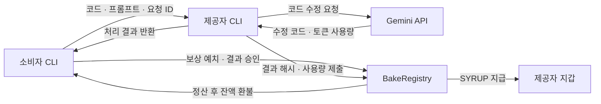

# Waffle

**개발자의 남는 LLM 사용량을 연결하는 CLI 기반 P2P 토큰 거래 플랫폼**

Waffle은 LLM 토큰이 필요한 개발자와 사용량에 여유가 있는 개발자를 연결합니다. 소비자가 코드와 수정 요청을 보내면, 제공자가 자신의 LLM 사용량으로 작업을 처리하고 결과 승인에 따라 보상을 받습니다.

남는 사용량을 다른 개발자의 작업에 활용해 자원 낭비와 추가 비용을 줄이고, 더 생산적인 개발자 커뮤니티를 만드는 것을 목표로 합니다.

현재는 같은 로컬 네트워크의 참여자를 연결하고, Gemini API와 테스트넷 기반 정산을 사용하는 프로토타입입니다.

## 기획 배경

개발캠프에서 어떤 참여자는 LLM 토큰이 남아도는 반면, 다른 참여자는 토큰이 부족한 상황을 관찰했습니다. 같은 커뮤니티 안에 활용할 수 있는 사용량이 남아 있어도, 필요한 사람이 이를 이용하기 어려웠습니다.

이러한 수급 불균형을 해결할 수 있다면 소비자는 다른 참여자의 남는 사용량을 구매해 개발을 이어가고, 제공자는 자신의 사용량을 활용해 보상을 받을 수 있다고 생각했습니다.

개인 간에 LLM 토큰을 직접 이전하기 어렵다는 제약을 고려해, 제공자가 자신의 사용량으로 소비자의 작업을 처리하는 구조를 고안했습니다. 첫 번째 적용 대상으로 코드 수정 작업을 선택하고, 개발자가 터미널에서 요청과 결과 검토를 진행할 수 있도록 CLI를 구현했습니다.

## 해결하고자 하는 문제

| 관찰한 문제 | Waffle의 접근 |
| --- | --- |
| 같은 커뮤니티에서 LLM 사용량의 잉여와 부족이 동시에 발생 | 소비자와 제공자를 연결해 남는 사용량을 작업 처리에 활용 |
| 개인 간 LLM 토큰을 직접 이전하기 어려움 | 제공자가 자신의 API로 소비자의 요청을 처리하는 방식으로 사용량 제공 |
| 작업 결과를 확인하고 대금을 지급할 절차가 필요 | 코드 변경 내역을 보여주고 소비자 승인에 따라 정산 |
| 도구 사용에 필요한 설정과 조작이 복잡해질 수 있음 | 설정 파일·지갑 생성 자동화와 CLI 기반 작업 흐름 구성 |

비용 절감과 자원 활용 개선은 프로젝트가 달성하고자 하는 목표입니다. 실제 효과는 소비자 비용, 제공자 참여 부담과 거래 사례를 통해 확인할 과제입니다.

## 동작 방식

### 참여자

- **소비자**는 수정할 코드와 프롬프트를 보내고, 결과를 검토한 뒤 대금을 지급합니다.
- **제공자**는 자신의 Gemini API로 요청을 처리하고, 수정된 코드와 토큰 사용량을 반환합니다.

Waffle에서 사용하는 두 종류의 토큰은 다음과 같습니다.

| 구분 | 역할 |
| --- | --- |
| LLM 토큰 | Gemini API가 작업을 처리하면서 사용하는 입력·출력 등의 사용량 단위 |
| SYRUP | 스마트 계약에서 예치와 대금 지급에 사용하는 결제용 ERC-20 토큰 |

### 기본 거래 흐름

1. 제공자가 `waffle serve`를 실행해 요청을 받을 준비를 합니다.
2. 소비자가 `waffle bake`에서 코드 파일을 선택합니다.
3. 소비자 노드가 피어를 탐색하고, 소비자가 수정 요청을 입력합니다.
4. 소비자는 보상 금액을 스마트 계약에 예치하고 요청을 생성합니다.
5. 코드, 프롬프트와 요청 ID를 P2P로 제공자에게 전달합니다.
6. 제공자는 Gemini API로 코드를 수정하고, 결과 해시와 토큰 사용량을 계약에 제출합니다.
7. 제공자가 수정된 코드와 토큰 사용량을 소비자에게 반환합니다.
8. 소비자는 변경 내역을 검토하고 결과를 승인합니다.
9. 승인에 따라 대금을 지급한 뒤 소비자의 파일에 수정본을 반영합니다.



`bake`에서 결과를 승인하면 요청 시 설정한 보상 금액을 지급합니다. 별도 `accept` 명령은 기록된 사용량과 설정된 단가를 이용하거나, 사용자가 지급액을 지정할 수 있도록 구현되어 있습니다. 지급액의 상한은 예치한 보상 금액입니다.

## 설계 방향

### 개인 간 직접 거래를 반영한 P2P 구조

남는 LLM 사용량을 개인 간에 거래한다는 기획 의도를 연결 구조에도 반영하기 위해 libp2p를 선택했습니다. 소비자와 제공자가 코드와 처리 결과를 직접 주고받도록 구성했습니다.

P2P를 선택하면서 피어 탐색, 연결 실패와 상대 노드의 상태를 다루는 과제도 생겼습니다. 이러한 연결 특성을 고려해 초기 적용 범위를 정했습니다.

### 같은 개발캠프에서 시작하는 로컬 네트워크

초기 사용자는 동일한 Wi-Fi를 사용하는 개발캠프 참여자였습니다. 실제로 관찰한 문제의 범위 안에서 거래 흐름을 먼저 구현하기 위해 mDNS 기반 로컬 네트워크 피어 탐색을 적용했습니다.

피어 주소를 직접 지정하는 연결 방식도 지원합니다. 외부 네트워크로 확장할 때는 NAT와 방화벽 환경, 피어 탐색과 연결 실패 처리를 추가로 검토할 계획입니다.

### 코드 전달과 거래 상태 관리

코드와 프롬프트, AI 처리 결과는 P2P 통신으로 전달합니다. 스마트 계약에는 코드·결과 해시, 참여자 주소, 보상 금액, 토큰 사용량과 요청 상태를 기록합니다.

소비자는 CLI에서 실제 수정 내용을 확인하고, 스마트 계약을 통해 승인과 정산을 수행합니다.

### 처음 사용하는 개발자를 고려한 CLI

파일 선택부터 결과 검토까지 터미널에서 진행하도록 구성했습니다. 최초 설정이 필요한 명령을 실행하면 설정 파일과 지갑을 생성하고, 반복적으로 필요한 초기화 처리를 공통화했습니다.

개발자가 도구를 이해하고 실행하기까지 필요한 설정과 조작을 줄이는 것을 사용성 개선의 방향으로 삼았습니다.

## 주요 기능

### P2P 통신

- libp2p 기반 노드 연결과 스트림 통신
- mDNS 기반 로컬 네트워크 피어 탐색
- 피어 주소를 직접 지정하는 연결
- 코드·프롬프트·요청 ID 전송
- 수정 코드·제공자 주소·토큰 사용량 반환

### CLI와 LLM 연동

- Cobra 기반 명령 체계
- Bubble Tea 기반 파일 선택 화면
- Gemini API를 이용한 코드 수정
- 응답 메타데이터에서 토큰 사용량 추출
- 코드 변경 내역과 변경 통계 표시
- 사용자 승인 후 정산과 파일 반영
- 초기 설정 파일과 지갑 자동 생성

현재 AI 연동 코드는 `gemini-2.5-flash` 모델을 사용하도록 설정되어 있습니다.

### 거래 상태 관리

- 요청별 소비자·제공자 주소와 코드·결과 해시 기록
- 결제용 SYRUP 토큰 예치
- 소비자의 결과 승인에 따른 지급
- 지급 후 남은 예치금 환불
- 대기 중 요청의 취소와 환불
- 요청 목록과 지갑 잔액 조회

기본 블록체인 연결 설정은 Base Sepolia 테스트넷을 기준으로 구성되어 있습니다.

## 주요 명령

| 명령 | 기능 |
| --- | --- |
| `waffle serve` | 제공자 모드로 실행하고 작업 요청 대기 |
| `waffle serve --port <port>` | 지정한 포트로 제공자 노드 실행 |
| `waffle bake` | 파일 선택과 코드 수정 요청 흐름 시작 |
| `waffle bake --reward <amount>` | 요청에 예치할 SYRUP 보상 금액 지정 |
| `waffle bake --peer <multiaddr>` | 피어 주소를 직접 지정해 연결 |
| `waffle requests` | 자신의 요청 목록 조회 |
| `waffle accept <request_id>` | 제출된 결과 승인 및 정산 |
| `waffle accept <request_id> --amount <amount>` | 지급액을 지정해 승인 |
| `waffle cancel <request_id>` | 대기 중인 요청 취소 |
| `waffle balance` | 지갑 잔액 조회 |

작업 처리에는 제공자의 Gemini API 인증 정보가 필요합니다. 소비자와 제공자는 동일한 블록체인과 계약을 사용해야 하며, 거래에 필요한 가스비와 소비자의 보상 예치용 SYRUP 잔액을 준비해야 합니다.

## 프로젝트 구조

```text
waffle/
├── cmd/waffle/          # CLI 명령과 사용자 작업 흐름
├── internal/
│   ├── ai/             # Gemini API 호출과 사용량 처리
│   ├── cli/            # 클라이언트 초기화, 자원 해제, 타임아웃
│   ├── config/         # 설정 로드와 초기 설정 생성
│   ├── contracts/      # 스마트 계약 연동
│   ├── p2p/            # 노드 연결, 피어 탐색, 요청·응답
│   ├── diff/           # 코드 변경 내역과 통계 표시
│   ├── patch/          # 패치 적용
│   ├── wallet/         # 지갑과 블록체인 클라이언트
│   ├── erc20/          # ERC-20 토큰 연동
│   ├── relay/          # 릴레이 클라이언트
│   └── ui/             # 터미널 UI 구성 요소
├── contracts/          # SYRUP 토큰과 거래 관리 계약
├── script/             # 스마트 계약 배포 스크립트
├── relay/              # 릴레이 서버
├── e2e_test.go         # 계약 연동 통합 테스트
├── .github/workflows/  # 릴리스 워크플로
└── .goreleaser.yaml     # 빌드와 패키징 설정
```

명령 처리와 AI 호출, 통신, 계약 연동을 패키지로 나누고, 여러 명령에서 사용하는 클라이언트 초기화·자원 해제·타임아웃 처리를 공통 함수로 구성했습니다.

## 테스트와 릴리스 설정

### 계약 연동 통합 테스트

로컬 Anvil 환경을 대상으로 다음 두 테스트를 작성했습니다.

| 테스트 | 확인하는 내용 |
| --- | --- |
| `TestE2EFullFlow` | 요청 생성, 결과 제출, 승인에 따른 상태 전이와 요청에 기록된 보상 금액 |
| `TestCancelRequest` | 요청 생성 후 취소 상태로의 전이 |

소비자와 제공자 계정을 분리해 계약을 호출하도록 구성했습니다. 테스트를 실행하려면 Anvil과 테스트 코드에 지정된 주소의 계약 배포가 준비되어 있어야 합니다.

현재 테스트의 대상은 계약 연동 흐름입니다. P2P 연결부터 실제 AI 처리와 파일 반영까지 이어지는 사용자 흐름은 추가 검증 과제입니다.

### 빌드와 배포 설정

GitHub Actions와 GoReleaser에 다음 작업을 설정했습니다.

- `v*` 태그를 기준으로 릴리스 작업 시작
- macOS·Linux의 amd64·arm64 바이너리 빌드
- 릴리스 버전 정보 삽입
- 배포 파일 압축과 체크섬 생성
- Homebrew Formula 생성과 배포 설정

현재 워크플로는 릴리스 작업을 대상으로 구성되어 있습니다. 테스트 자동 실행과 빌드 도구·의존성 버전 정합성 검증은 보완 과제입니다.

## 보안 현황과 설계 과제

### 소비자 데이터의 처리 범위

P2P 전송 구간에는 libp2p의 기본 보안 채널을 사용합니다. 제공자는 수신한 코드와 프롬프트를 Gemini API에 전달해 결과를 생성합니다.

현재 제공자 화면에는 코드 본문을 출력하지 않으며, 프롬프트와 파일 크기는 출력됩니다. 제공자 프로세스는 처리 과정에서 코드와 프롬프트의 평문에 접근할 수 있습니다.

추가 데이터 보호를 위해서는 로그 노출 최소화와 함께 암호화 범위, 복호화 권한, 키 관리와 실행 위치를 검토해야 합니다. 제공자 실행 환경에서 원문을 어떻게 보호할 것인지가 주요 설계 과제입니다.

### 직접 거래와 중앙 통제 사이의 고민

개인 간 직접 거래라는 방향성으로 P2P를 선택했지만, 데이터 보호를 고려하면서 신뢰 범위에 대한 고민이 생겼습니다.

신뢰할 수 있는 중앙 서버에서 LLM 호출까지 처리하면 개별 제공자의 원문 접근을 제한하고 접근 권한과 로그 정책을 일관되게 관리하기 수월해집니다. 동시에 중앙 서버 운영자에 대한 신뢰와 제공자의 API 인증 정보 관리 책임이 추가됩니다.

개인 간 거래라는 기획 의도와 소비자 데이터 보호를 함께 만족시키기 위해, 어느 범위까지 분산하고 어디에 통제를 둘 것인지 검토하고자 합니다.

## 개선 방향

- **네트워크 확장**  
  서로 다른 네트워크에서의 피어 탐색, NAT·방화벽 환경과 연결 실패 처리 검증.

- **거래 흐름의 안정성**  
  요청 ID 경계값, 결과 거절 이후의 상태 처리, 정산과 파일 반영 사이의 실패에 대한 복구 방식 보완.

- **사용자 데이터 보호**  
  민감 정보의 로그 노출 최소화, 원문 접근 권한과 실행 위치, 키 관리 구조 검토.

- **검증 범위 확대**  
  P2P 통신, 실제 AI 응답, 정산과 파일 반영을 포함한 전체 흐름 검증 및 테스트 자동화.

- **문제 해결 효과 확인**  
  실제 사용 사례를 통해 소비자의 비용, 제공자의 참여 부담과 유휴 사용량 활용 효과 확인.

## 기술 스택

| 영역 | 기술 |
| --- | --- |
| CLI | Go, Cobra |
| 터미널 UI | Bubble Tea, Lip Gloss |
| P2P 통신 | libp2p, mDNS |
| LLM 연동 | Gemini API |
| 스마트 계약 | Solidity, OpenZeppelin Contracts |
| 계약 개발 환경 | Foundry, Anvil |
| 블록체인 연동 | go-ethereum |
| 릴리스 설정 | GitHub Actions, GoReleaser |
